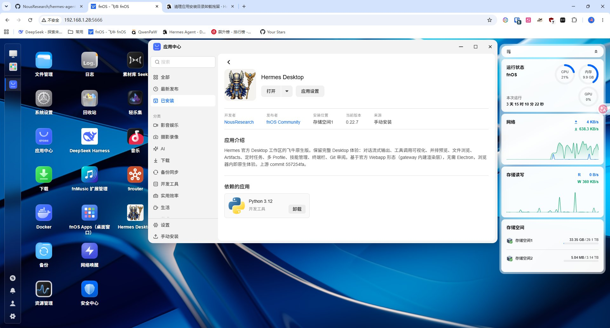
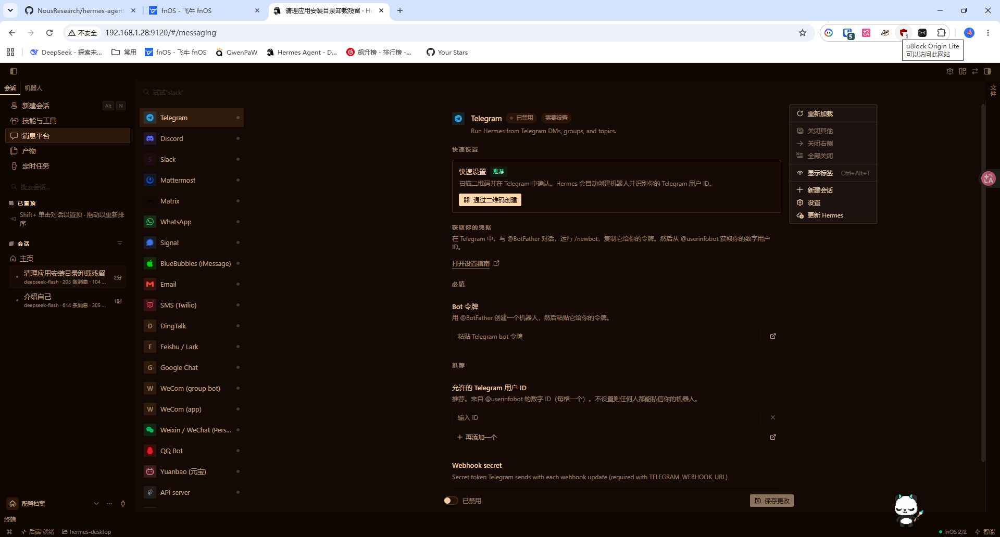

# Hermes Desktop for fnOS

飞牛 NAS（fnOS）上的 **Hermes Desktop 官方桌面工作区** —— 用官方自带的 Webapp 形态承载，
**不改动任何上游代码**，无需 Electron，无需虚拟显示串流。

[English](README.en.md) · [实施报告](docs/IMPLEMENTATION.md)

> 打包分发：[巴盟女婿](https://github.com/sfy2022/fnos-hermes-desktop)
> 上游：[NousResearch/hermes-agent](https://github.com/NousResearch/hermes-agent)

---

## 这是什么

Hermes 官方桌面端（Electron）的渲染层有两套构建产物：

| 产物 | 用途 | 本项目 |
|---|---|---|
| Electron 包（AppImage/deb/rpm） | 桌面客户端 | 官方 Linux 发行腿已禁用，NAS 也无显示环境 |
| **Webapp bundle**（`dist-webapp`） | **浏览器里的 Desktop 工作区** | ✅ 采用 |

上游 `hermes_cli/webapp.py` 的注释说明了设计意图：

> *Build and launch plumbing for the browser-hosted **Desktop workspace**. The browser surface
> **shares Hermes' hardened dashboard server**... it never creates a second HTTP/WebSocket stack.*

也就是说，官方 Desktop 的 UI 与浏览器 Dashboard **共用同一套传输层、同一套会话与工具**。
本项目做的是：**把官方构建产物打包成 fnOS 应用**，让 NAS 桌面上点图标就能用。

**结果**：你在 NAS 上看到的是**原版 Desktop 界面**，不是仿制品。

---

## 两种打开方式

安装后桌面上会出现对应图标，两种方式访问**同一个后端、同一份会话**：

| 方式 | 地址 | 鉴权 | 适用场景 |
|---|---|---|---|
| **网页入口（推荐）** | `http://<NAS_IP>:9120` | Hermes 自身 `basic_auth`，登录一次后浏览器记住 | 手机、平板、其他电脑 |
| **桌面内嵌（实验性）** | 飞牛统一网关 `/app/hermes-desktop` | 飞牛登录态 | 想在飞牛窗口内使用 |

### 为什么内嵌标注为实验性

Desktop 工作区依赖一条 WebSocket（前端称之为 *Desktop IPC bridge*）承载工具调用与流式输出。
内嵌入口经飞牛统一网关代理，这条 WS 需要满足三个条件才能通：

1. 网关**透传 `Upgrade: websocket`**（部分版本不支持）
2. 代理层能把前端的所有路由正确挂到子路径下（本项目已通过改写
   `window.__HERMES_BASE_PATH__` 解决）
3. WS 端点接受的会话凭证在子路径下仍有效

其中第 1、3 项依赖飞牛网关实现，本项目无法完全控制。若页面提示
`Desktop IPC bridge is unavailable`，请改用网页入口 —— 它不经过网关，功能完整。

---

## 界面预览

| 飞牛应用中心 | 消息平台 |
|---|---|
|  |  |

左：在飞牛应用中心里就是一个普通应用，版本与来源一目了然。
右：内置消息平台接入 —— Telegram / Discord / Slack / Mattermost / Matrix /
WhatsApp / Signal / BlueBubbles / Email / SMS / 钉钉 / 飞书 / Google Chat /
企业微信 / 微信 / QQ Bot / 元宝，填好 Bot 令牌即可让 Agent 在聊天里干活。

---

## 首次使用

1. 点图标打开（网页入口需登录，见安装时设置的密码）
2. 首次进入是**模型接入向导**：选自己的 API Key，或先点「稍后选择」
3. 之后即可新建会话对话。`hermes doctor` 可随时体检

---

## fnOS 授权面板

装完自带一个「fnOS 授权」面板，用来给 Agent 开通本机或其它 fnOS 设备的操作权限
（文件、Docker、应用中心、存储、监控等）。

**入口在右下角状态栏**：

```
 ● fnOS 1/2        ← 已授权 / 总数（琥珀点=还有未授权），点击进入面板
```

也可以直接访问 `http://<nas>:9120/#/fnos-auth`。

### 用法

1. 面板顶部填 NAS 地址（`192.168.1.28` 或 `nas.example.com:5666`）→ **添加**
2. 点该设备的 **发起授权** → 出现一条登录链接
3. 浏览器打开链接 → 用飞牛账号登录并确认授权
4. 复制页面给出的授权码 → 粘回面板 → **提交**

> **一次只用一个链接。** 每次点「发起授权 / 重新授权」都会生成新的 client_id，
> 上一个立即失效。面板加了 2.5 秒冷却来避免误连点。

### 为什么不放在左侧导航

这个前端版本的插件贡献区只有 `layouts / panes / routes / statusBar.* / titleBar.*`，
**没有 nav / sidebar** —— 插件无法往左侧导航插入口，`routes` 只注册路由不生成导航项。
所以入口落在状态栏，同时兼作授权进度指示。

### 对应的 agent 工具

面板背后是同一套 API，agent 也能直接调用：
`fnos_auth_devices`、`fnos_auth_add`、`fnos_auth_start`、`fnos_auth_submit`、
`fnos_auth_check`、`fnos_auth_logout`。在会话里说「给 E5 授权」即可。

---

## 功能

与官方 Desktop Webapp 一致（官方文档 `user-guide/desktop.md`）：

- **对话**：流式响应、实时工具活动、结构化工具调用摘要
- **并排预览**：网页 / 文件 / 工具输出同屏
- **文件浏览**：直接浏览工作目录
- **Artifacts**：会话产出物画廊
- **定时任务**、**多 Profile**、**技能管理**
- **终端栏**、**Git 审阅**
- **消息网关**：微信 / QQ / 飞书 / Telegram / Discord / Slack 等
- **MCP 集成**、**持久记忆**
- **内置飞牛官方 Skill**：装完即可操控本机 fnOS（文件、Docker、应用中心、存储、监控…）

与原生 CLI / Desktop / 网关共享同一会话与队列。

### 内置飞牛 Skill

本应用内置**飞牛官方 fnOS Skill**（trim-cli + 知识文档），装完 Agent 就具备操作
本机 NAS 的能力：文件管理、Docker 控制、应用中心（查询/安装/启停/卸载）、
存储与 RAID、相册与媒体库、日志与监控、网络与电源、用户与权限、下载任务。

**需要一次 OAuth 授权**（trim-cli 使用 Authorization Code + PKCE，Agent 不能代你确认）：

```bash
/var/apps/hermes-desktop/var/skills/fnos-trim/scripts/trim-cli login --no-open
```

命令会打印一个 `http://<NAS_IP>:5666/signin?...` 链接，在浏览器打开并确认授权，
把返回的授权码粘贴回命令提示即可。授权状态可用
`cmd/main setup-fnos` 查看。

授权 token 存在应用数据目录（`~/.config/trim-cli/`），卸载保留、重装免重新授权。

> ⚠️ 授权后 Agent 等同于拥有你的 fnOS 账号权限。请遵循最小权限原则，
> 只勾选真正需要的模块（scope 按模块申请）。

### 相对 Electron 少了什么（浏览器形态的固有限制）

- 全局快捷键、置顶浮窗、外部终端唤起
- `safeStorage` 凭据加密存储
- 麦克风 / 语音、系统通知、剪贴板读取（HTTP 非安全上下文下浏览器禁用）

需要这些能力时，在你的 Windows/macOS 上装原生 Desktop，用 **remote mode** 连同一个 gateway 即可。

---

## 安装

飞牛桌面 → **应用中心** → 右上角 **手动安装** → 选择 `hermes-desktop.fpk`

安装向导会询问：

1. **访问用户名 / 密码**（密码留空则自动生成 20 位随机强密码，可在应用数据目录 `access-info.txt` 查看）
2. **GitHub 下载通道**（默认自动探测）与 **Python 依赖源**（默认 PyPI 官方）

安装完成后：

1. 桌面出现 **Hermes Desktop** 图标，点击在飞牛窗口内打开
2. 首次进入会要求配置模型供应商（也可在向导阶段先填 API Key）
3. 想让 Agent 操控 NAS，把[官方 fnOS Skill](https://club.fnnas.com/forum.php?mod=viewthread&tid=67918)喂给它

---

## 安全

⚠️ **登录后的用户等同于授予本机命令执行权限**（能跑 terminal 工具、读写文件、访问凭据）。

- 本应用绑定 `0.0.0.0:9120`，因此 **Hermes 强制要求配置认证** ——
  上游 `should_require_auth()` 只看绑定地址，非回环即启用认证门。
  若 `config.yaml` 里没有 `dashboard.basic_auth`，Hermes 会**拒绝启动 webapp**：
  gateway 主循环照跑、进程活着、端口却不监听，外部表现就是「打不开 / 502」。
  日志原文：`Refusing to bind dashboard to 0.0.0.0 — the auth gate engages on
  non-loopback binds, but no auth providers are registered`
- **切勿直接暴露到公网**。需要外网访问请用 VPN / Tailscale，或反代 + HTTPS
- 改密码：`dashboard.basic_auth.password_hash` 要求 **scrypt 哈希，不能写明文**：

  ```bash
  cd /vol1/@appdata/hermes-desktop
  HERMES_PW='你的新密码' PYTHONPATH=src venv/bin/python3 -c \
    'import os; from plugins.dashboard_auth.basic import hash_password; \
     print(hash_password(os.environ["HERMES_PW"]))'
  ```

  把输出写进 `config.yaml` 的 `password_hash`，然后重启应用。

---

## 自动构建

本仓库用 GitHub Actions 自动同步上游并产出 fpk：

| 工作流 | 触发 | 作用 |
|---|---|---|
| `sync.yml` | 每 6 小时 | 对比上游 commit，有变化才触发构建 |
| `build.yml` | 每日 03:17 / 手动 / 脚本变更 | 克隆上游 → 构建渲染层 → 打包 fpk → 发 Release |

构建产物在 **Releases** 页，直接下载 `hermes-desktop.fpk` 安装。

### 本地构建

需要 **Node >= 26**（上游 build 脚本的硬性要求）与 git/curl：

```bash
bash scripts/build.sh
# 产物：dist/hermes-desktop.fpk + dist/build-info.json
```

可用环境变量：

```bash
UPSTREAM_REF=v0.22.5   # 构建指定上游版本
SKIP_BUNDLE=1          # 复用已有渲染层
OUTPUT_DIR=/path/out   # 指定输出目录
```

---

## 常见问题

### 点「启动」报错 / 打不开 / 502

**先看 Hermes 自己的日志**，而不是安装脚本的 info.log：

```bash
tail -50 /vol1/@appdata/hermes-desktop/logs/gateway.log
```

安装脚本的 `info.log` 往往只有一行启动横幅 —— 因为进程可能在**日志初始化之前**就退出了。

最常见的两个原因：

| 现象 | 原因 | 处理 |
|---|---|---|
| `Refusing to bind dashboard to 0.0.0.0` | `config.yaml` 绑了 `0.0.0.0` 但缺 `dashboard.basic_auth` | 补上 `basic_auth`（见「安全」节），或改绑 `127.0.0.1` |
| 启动横幅一闪而过、无任何报错 | 数据目录里混入了**非应用属主**的文件 | 见下条 |

### 数据目录混入其他用户属主的文件

Hermes 以 `hermes-desktop` 身份运行。若用其他账号（比如 SSH 登录的管理员）
手工跑过 `hermes`，会留下 `sun` 属主的文件 —— `webapp/session-token`、
`gateway.lock`、`tools/` 等。应用身份读写不了这些文件，**会在日志初始化之前
静默退出**，日志里一行错都没有。

排查与修复（需 root 或应用身份）：

```bash
# 找出不是应用属主的条目
find /vol1/@appdata/hermes-desktop ! -user hermes-desktop

# 删掉让应用身份重建（先确认没有重要数据）
```

**教训：不要用别的账号手动跑 Hermes。** 排障请用 Web UI 的终端栏（那里是应用身份）。

### 内嵌窗口提示 `Desktop IPC bridge is unavailable`

这是 WebSocket 没通。内嵌入口经飞牛网关代理，需要网关透传 `Upgrade: websocket`。
**改用网页入口即可**，它不经过网关。

### 内嵌登录后跳到飞牛桌面

Hermes 前端用 `window.__HERMES_BASE_PATH__` 拼所有路由。上游注入的是空串
（站点根），在网关子路径下 `location.href = basePath + "/"` 就落到 `/` —— 也就是飞牛桌面。
本项目在 `rewrite_html` 里把它改写为网关前缀，已修复。若仍出现，检查适配层是否加载了新脚本。

### 安装时报 `A directory already exists at .../venv`

卸载时选了「保留数据」或卸载中断，`venv` 残留。新版本已用 `uv venv --clear`
并加了残留兜底；旧包可手动 `rm -rf /vol1/@appdata/hermes-desktop/venv` 后重装。

---

## 技术要点（踩坑记录）

这些是实机验证中踩出来的，都已固化进 `scripts/build.sh` 与 `packaging/fpk/cmd/`。

### 构建侧

- **Node 必须 >= 26**：上游 `scripts/build/node-deps.mjs` 硬性检查，Node 22 会被拒
- **渲染层构建要跳过 Electron 二进制**：`build-webapp.mjs` 已内置处理（`electron: false`）
- **渲染层不提交进仓库**：47MB / 1081 文件，每次构建重新生成

### 运行时侧（fpk 安装脚本）

1. **必须装 GitHub 源码版**：PyPI 上 `hermes-agent` 最高 0.19.0，而该版本**没有 `hermes webapp` 命令**
2. **必须 Python 3.14**：依赖按 `python_version >= '3.14'` 声明（`ruamel.yaml`），但代码无条件 import
3. **依赖解析必须用官方 PyPI 源** + `--exclude-newer 2027-01-01`：
   uv 0.13+ 默认带 `exclude-newer`（其构建日），而**国内镜像不携带 upload-time 元数据**，
   导致依赖被全部误判"过新"而过滤
4. **GitHub 多路备援**：git clone → codeload → gh-proxy.com → ghproxy.net → 直连；
   NAS 上 `curl` 必须加 `--http1.1`
5. **uv 下载不能拼 URL**：wheel 文件名带版本号且各源命名不同，改用 PyPI JSON API 定位
6. **`TRIM_SERVICE_PORT` 可能为空**：需兜底到 9120 并做数字校验
7. **fnOS `wizard/*` 必须是 JSON 数组**：写成 shell 会导致 `fnpack build` 直接报错

---

## 目录结构

```
.
├── .github/workflows/
│   ├── build.yml              # 构建 + 发布
│   └── sync.yml               # 上游变更检测
├── scripts/
│   └── build.sh               # 完整构建流程
├── packaging/fpk/             # fpk 模板（渲染层在构建时注入）
│   ├── manifest
│   ├── cmd/                   # 生命周期脚本
│   ├── config/                # privilege / resource
│   ├── wizard/                # 安装向导（JSON）
│   └── app/ui/config          # 桌面入口（iframe → 9120）
└── docs/IMPLEMENTATION.md     # 实施报告
```

---

## 相关链接

- 上游：<https://github.com/NousResearch/hermes-agent>
- 官方 Desktop 文档：<https://hermes-agent.nousresearch.com/docs/user-guide/desktop>
- fnOS 开发者文档：<https://developer.fnnas.com/>
- fnpack：<https://developer.fnnas.com/docs/cli/fnpack>

## 许可

本仓库（fpk 打包与自动化流水线部分）为社区贡献的开源项目。
上游 Hermes Agent 遵循其自身许可（MIT）。

---

## 推送到 GitHub

```bash
# 1. 生成 token（GitHub → Settings → Developer settings → Personal access tokens）
#    勾选 repo（读写仓库）与 workflow（触发 CI）
export GITHUB_TOKEN=ghp_xxxxxxxxxxxxxxxx

# 2. 创建仓库并推送
gh repo create <your-username> --public --description "..." \
  --source=. --remote=origin --push

# 或者用本仓库自带的脚本（自动做隐私自检 + 触发 CI）
bash scripts/push.sh github <your-username>
```

### 凭据安全

`scripts/push.sh` 的凭据处理遵循以下原则：

| 做法 | 原因 |
|---|---|
| token 只从**环境变量**读取 | 避免进入 shell 历史（`history`）与进程列表（`ps aux`） |
| 用 `GIT_ASKPASS` + 临时文件传递 | 不进 `.git/config`，不会被 `git remote -v` 显示 |
| 临时文件权限 600，退出即 `shred` | 即使脚本异常中断也不残留 |
| 推送前自动跑隐私自检 | 硬编码的 token / 密码 / 内网 IP 会被拦下 |
| 提交身份固定 `noreply` | 不在提交历史里留下真实邮箱 |

> ⚠️ `~/.git-credentials` 是**明文**存储。若用 `git credential store`，
> 请确认该文件不在任何同步盘或版本库里。

### 隐私自检

```bash
python3 scripts/privacy_check.py            # 工作区 + 完整历史
python3 scripts/privacy_check.py --staged   # 只看将要提交的内容
```

检查项：内网 IP、硬编码凭据、访问令牌、私钥内容、个人邮箱，
以及提交身份是否为 noreply。

---

## 在 Gitea 上运行 CI

本仓库的工作流**同时兼容 GitHub Actions 与 Gitea Actions**（已在你自建的
Gitea `<gitea-host>` 上验证被正确识别）。

### 已做的兼容处理

| 差异点 | 处理方式 |
|---|---|
| Release API | 抽到 `scripts/publish_release.py`，按 `GITHUB_API_URL` 自动适配（两平台路径一致） |
| `actions/github-script`（GitHub 专属） | 移除，改用 curl 调 Gitea 的 dispatch API |
| `actions/upload-artifact@v4` | 降级到 `v3`（Gitea 只支持到 v3，GitHub 同样接受） |
| `actions/setup-node` | 改为直接下载 Node 26 二进制，避免 action 源差异与版本清单滞后 |
| 触发方式 | Gitea 走 dispatch API，GitHub 走 `gh` CLI |

### 启用 Gitea Actions

Gitea 需要 **runner** 才能执行工作流。步骤：

1. 在 Gitea 打开仓库 → **Settings** → **Actions** → **Runners** → **New runner**
2. 选择 **docker** 或 **host** 模式，复制注册命令
3. 在你的构建机上执行（用 `act_runner` 官方镜像）：

```bash
docker run -d \
  --name gitea-runner \
  --restart always \
  -e GITEA_INSTANCE_URL="https://<gitea-host>" \
  -e GITEA_RUNNER_REGISTRATION_TOKEN="<上一步复制的 token>" \
  -e GITEA_RUNNER_NAME="fnos-builder" \
  -e GITEA_RUNNER_LABELS="ubuntu-latest:docker://node:26-bookworm" \
  -v /var/run/docker.sock:/var/run/docker.sock \
  gitea/act_runner:latest
```

> 用 `node:26-bookworm` 作为任务镜像：官方 build 脚本要求 Node ≥ 26。

4. 之后仓库的 Actions 页面就能看到两个工作流：
   - **同步上游并构建**（每日 03:17 + 手动）
   - **检查上游更新**（每 6 小时，有变化才触发构建）

### 需要配置的 Secret

仓库 **Settings** → **Actions** → **Secrets**：

| 名称 | 用途 |
|---|---|
| `GITEA_TOKEN` | 发布 Release 用。在 Gitea **Settings** → **Applications** 生成，勾选 `write:repository` |

未配置 `GITEA_TOKEN` 时，构建仍会正常完成，只是跳过 Release 发布步骤
（产物可从 Actions 的 artifact 下载）。

### 手动触发

```bash
curl -H "Authorization: token <GITEA_TOKEN>" \
  -H "Content-Type: application/json" \
  -X POST "https://<gitea-host>/api/v1/repos/<owner>/<repo>/actions/workflows/build.yml/dispatches" \
  -d '{"ref":"main"}'
```
